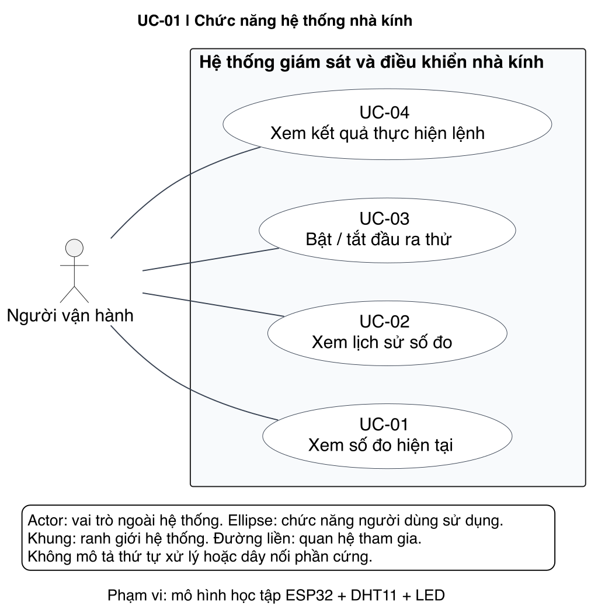
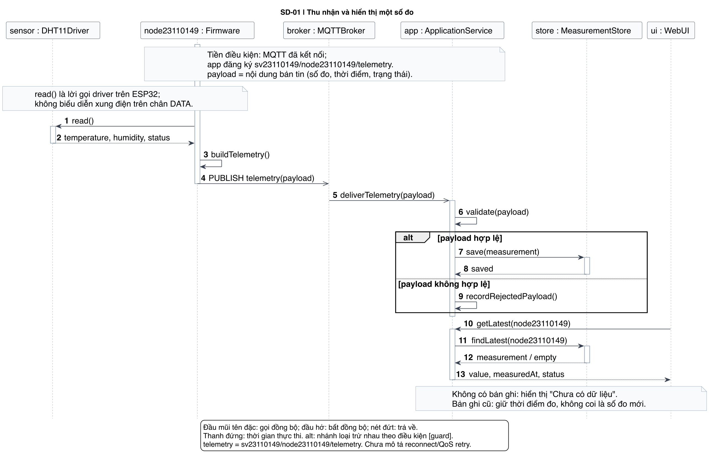
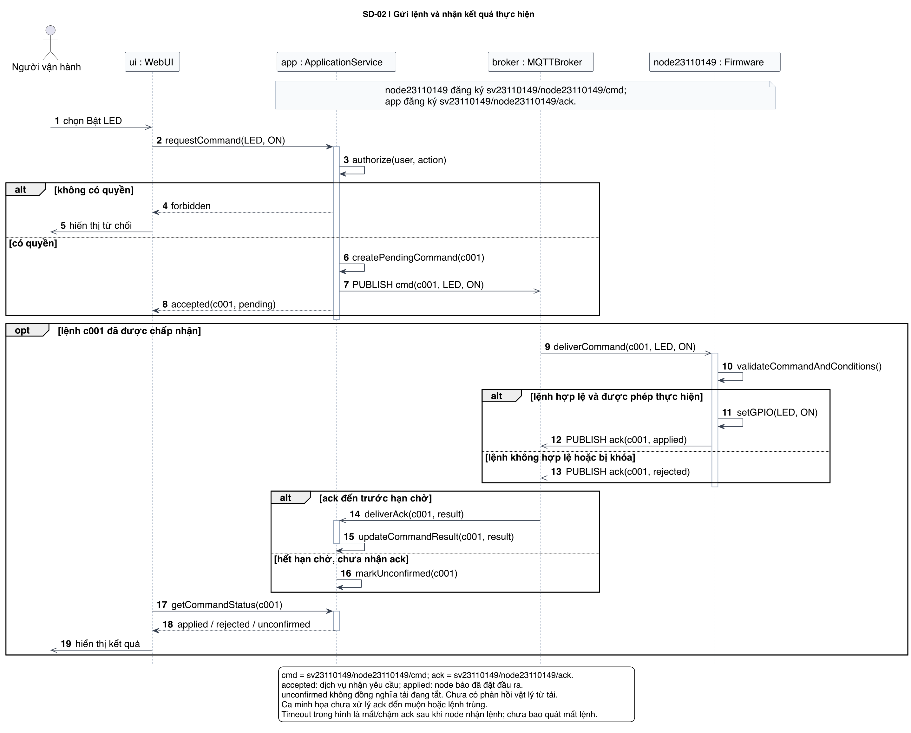
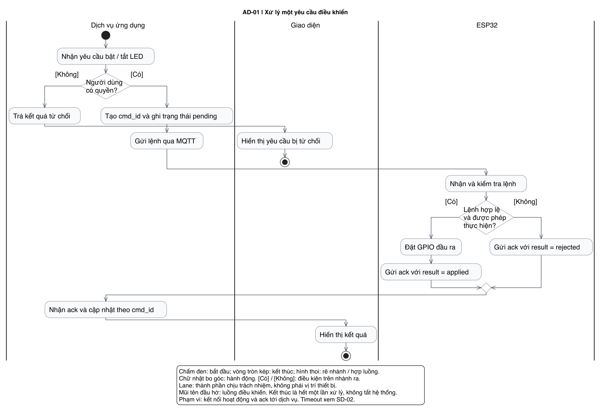
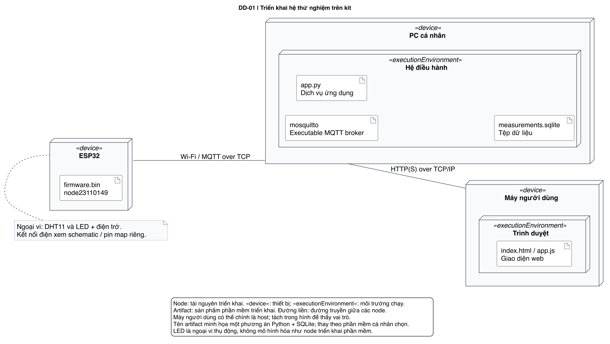

# TH01 — Đọc mạch và vẽ hệ thống theo mẫu

**Họ và Tên:** Nguyễn Quang Anh
**Mã sinh viên:** 23110149    
**Học phần:** CSE3069 - Ứng dụng IoT

Bài thực hành gồm phần trả lời câu hỏi đọc schematic Farm House Rev 1.0.1 và bộ 5 sơ đồ UML làm theo mẫu của giảng viên.

## Mục lục

- [1. Câu hỏi đọc mạch](#1-câu-hỏi-đọc-mạch)
- [2. Năm sơ đồ UML](#2-năm-sơ-đồ-uml)
- [3. Giải thích các sơ đồ](#3-giải-thích-các-sơ-đồ)
- [4. Phạm vi kiểm chứng](#4-phạm-vi-kiểm-chứng)
- [5. Tài liệu tham khảo](#5-tài-liệu-tham-khảo)

## 1. Câu hỏi đọc mạch

### Câu 1. Hai họ vi điều khiển trong nhà kính là gì? 
Arduino_Uno_R3 và ESP32-DEVKITC-32E.

### Câu 2. Cảm biến nhiệt độ/độ ẩm phía ESP32 tên gì? 
DHT11.

### Câu 3. DATA_RH nối GPIO nào?
DATA_RH nối với  GPIO14 của ESP32, tại chân đầu cắm J2_12.

### Câu 4. Cảm biến này dùng kiểu giao tiếp nào?
DHT11 sử dụng giao tiếp số một dây dữ liệu (single-wire/single-bus) theo giao thức riêng, truyền và nhận dữ liệu qua chân DATA.

### Câu 5. SDA nối GPIO nào?
SDA nối GPIO33 của ESP32 U1, tại J2_8.

### Câu 6. SCL nối GPIO nào?
SCL nối GPIO32 của ESP32, tại J2_7.

### Câu 7. MOTOR1_INT1 nối GPIO nào?
MOTOR1_INT1 nối GPIO5 của ESP32, tại J3_10.

### Câu 8. MOTOR1_INT2 nối GPIO nào?
MOTOR1_INT2 nối GPIO17 của ESP32 U1, tại J3_11.

### Câu 9. Truy vết từ hai GPIO tới động cơ. Vì sao không nối tải trực tiếp vào GPIO?
Hai đường điều khiển MOTOR1 ở trang 4 đi như sau:
- GPIO5 → MOTOR1_INT1 → R37 (22 Ω) → IN1, chân 3 của U9.
- GPIO17 → MOTOR1_INT2 → R53 (22 Ω) → IN2, chân 2 của U9.
- U9 là IC A4950ELJTR; hai ngõ ra OUT1 (chân 6) và OUT2 (chân 8) nối tới chân 1 và chân 2 của J9, nơi đấu động cơ 1.

Không nối động cơ trực tiếp vào GPIO vì động cơ cần dòng điện lớn, có thể làm hỏng chân GPIO. GPIO chỉ gửi tín hiệu cho U9; U9 lấy nguồn VDC để chạy và điều khiển chiều quay động cơ.

### Câu 10. LED_R nối GPIO nào của ESP32 U1?
LED_R nối GPIO26 của ESP32 U1, tại J2_10.

### Câu 11. LED_G nối GPIO nào của ESP32 U1?
LED_G nối GPIO27 của ESP32 U1, tại J2_11.

### Câu 12. LED đỏ D3 và LED xanh D16 được điều khiển trực tiếp từ GPIO hay qua linh kiện nào? Truy vết một nhánh.
Hai LED được điều khiển qua transistor NPN MMBT3904, không được cấp dòng trực tiếp từ GPIO:
- LED đỏ D3: transistor Q6, tín hiệu LED_R.
- LED xanh D16: transistor Q12, tín hiệu LED_G.

Truy vết nhánh LED đỏ: GPIO26 → LED_R → R14 (1 kΩ) → Q6. Cực E của Q6 nối GND; cực C nối nhánh LED D3. Dòng qua LED đi theo đường +5V → R9 (1 kΩ) → D3 → Q6 → GND khi Q6 dẫn. R15 (10 kΩ) kéo cực B xuống GND để giữ trạng thái tắt khi không có tín hiệu điều khiển.

### Câu 13. MOTOR2_INT1 nối GPIO nào?
MOTOR2_INT1 nối GPIO23 của ESP32, tại J3_2.

### Câu 14. MOTOR2_INT2 nối GPIO nào?
MOTOR2_INT2 nối GPIO22 của ESP32, tại J3_3.

### Câu 15. MOTOR2 đi qua IC nào và ra đầu nối nào? Vì sao không nhầm với MOTOR1?
MOTOR2 đi qua U3 — A4950ELJTR và ra đầu nối J10:
- GPIO23 → MOTOR2_INT1 → R33 (22 Ω) → IN1, chân 3 của U3.
- GPIO22 → MOTOR2_INT2 → R34 (22 Ω) → IN2, chân 2 của U3.
- OUT1 (chân 6) và OUT2 (chân 8) của U3 nối tới chân 1 và chân 2 của J10.

Cả J9 và J10 đều có dòng chữ “MOTOR01”. Vì vậy không dùng riêng dòng chữ đó để nhận diện; phải truy vết MOTOR1_INT1/2 hoặc MOTOR2_INT1/2, đối chiếu U9/U3 và J9/J10.

### Câu 16. Phân biệt LED báo đỏ/xanh với hai nhánh ARRAY_LED. ARRAY_LED3/4 nối GPIO nào và đi tới nhánh nào?
LED báo đỏ/xanh là D3 và D16, dùng nguồn +5V, được điều khiển qua các transistor nhỏ Q6/Q12 bởi LED_R/LED_G.
Hai nhánh ARRAY_LED dùng nguồn VDC, điều khiển qua IC N531 và MOSFET 30N06:
- GPIO13 → ARRAY_LED3 → U11 → Q10, đóng cắt tải ở nhánh ARRAY_LED1, đầu nối J11.
- GPIO12 → ARRAY_LED4 → U12 → Q11, đóng cắt tải ở nhánh ARRAY_LED2, đầu nối J13.

Tên tín hiệu ARRAY_LED3/4 khác với tên khối ARRAY_LED1/2. Vì vậy cần lần theo nhãn, không ghép nhánh chỉ theo số trong tên. Đây cũng không phải hai LED báo D3/D16.

### Câu 17. Theo nhà kính này, một số đo DHT11 được đọc ở chân nào? Nếu bổ sung điều khiển MOTOR1 qua MQTT thì lệnh phải đi tới hai GPIO nào, qua mạch nào?
ESP32 đọc số đo DHT11 qua GPIO14, đường DATA_RH, kết nối tới chân dữ liệu của cảm biến qua J1 và R28.

Nếu bổ sung điều khiển MOTOR1 qua MQTT, đường xử lý dự kiến là:
Giao diện → dịch vụ → MQTT broker → chương trình trên ESP32 → GPIO18/GPIO17 → U9 A4950ELJTR → J9 → động cơ 1.

Chương trình ESP32 nhận và giải mã bản tin MQTT rồi đặt hai tín hiệu:
- GPIO18: MOTOR1_INT1 → R37 → IN1 của U9.
- GPIO17: MOTOR1_INT2 → R53 → IN2 của U9.

## 2. Năm sơ đồ UML

| STT | Sơ đồ | Ảnh PNG | Mã nguồn PlantUML |
|---|---|---|---|
| 1 | Chức năng — Use Case | [Xem ảnh](01-chuc-nang.png) | [Xem PUML](01-chuc-nang.puml) |
| 2 | Luồng số đo — Sequence | [Xem ảnh](02-luong-so-do.png) | [Xem PUML](02-luong-so-do.puml) |
| 3 | Luồng lệnh và xác nhận — Sequence | [Xem ảnh](03-luong-lenh.png) | [Xem PUML](03-luong-lenh.puml) |
| 4 | Quy trình xử lý lệnh — Activity | [Xem ảnh](04-hoat-dong.png) | [Xem PUML](04-hoat-dong.puml) |
| 5 | Triển khai hệ thống — Deployment | [Xem ảnh](05-trien-khai.png) | [Xem PUML](05-trien-khai.puml) |

### Xem các sơ đồ

1. Chức năng — Use Case

2. Luồng số đo — Sequence

3. Luồng lệnh và xác nhận — Sequence

4. Quy trình xử lý lệnh — Activity

5. Triển khai hệ thống — Deployment

## 3. Giải thích các sơ đồ

### Một số đo đi đâu?

Theo mô hình UML mẫu: **DHT11 → chương trình ESP32 → MQTT broker → dịch vụ ứng dụng → cơ sở dữ liệu → giao diện**. Dịch vụ kiểm tra bản tin trước khi lưu; khi giao diện yêu cầu, dịch vụ đọc bản ghi mới nhất để trả về số đo, thời điểm và trạng thái.

### Một lệnh đi đâu?

**Người vận hành → giao diện → dịch vụ ứng dụng → MQTT broker → ESP32 → LED thử nghiệm.** ESP32 kiểm tra lệnh, đặt GPIO nếu được phép và gửi bản tin `ack` qua broker về dịch vụ. Giao diện lấy trạng thái lệnh từ dịch vụ để hiển thị kết quả.

### Broker có tự đọc cảm biến không?

Không. Chương trình trên thiết bị đọc cảm biến và gửi số đo. **Broker chỉ chuyển bản tin** đến các bên đăng ký topic; **dịch vụ ứng dụng xử lý và lưu dữ liệu**.

### Có ack nghĩa là gì?

`ack` là bản tin phản hồi kết quả từ thiết bị. `applied` có nghĩa thiết bị báo đã đặt đầu ra; `rejected` là thiết bị từ chối thực hiện. Nếu chưa nhận `ack` trước hạn chờ, dịch vụ ghi `unconfirmed`. Chưa có phép đo độc lập chứng minh LED hoặc tải vật lý đã hoạt động.

### Đã thay đổi gì từ mẫu?

Cá nhân hóa tiền tố topic thành `sv23110149`, mã thiết bị thành `node23110149`, chọn PC cá nhân trong sơ đồ Deployment. Nội dung chức năng và các nhánh xử lý được giữ theo mẫu.

### Đường nối Use Case có phải luồng dữ liệu không?

Không. Đường liền giữa actor và use case thể hiện vai trò đó tham gia chức năng nào; không biểu diễn thứ tự xử lý, luồng dữ liệu hoặc dây nối phần cứng.

### Activity và Sequence khác nhau thế nào?

- **Activity:** mô tả các bước xử lý, điều kiện rẽ nhánh và thành phần chịu trách nhiệm.
- **Sequence:** mô tả các đối tượng trao đổi thông điệp theo thứ tự thời gian, gồm lời gọi, bản tin và phản hồi.
