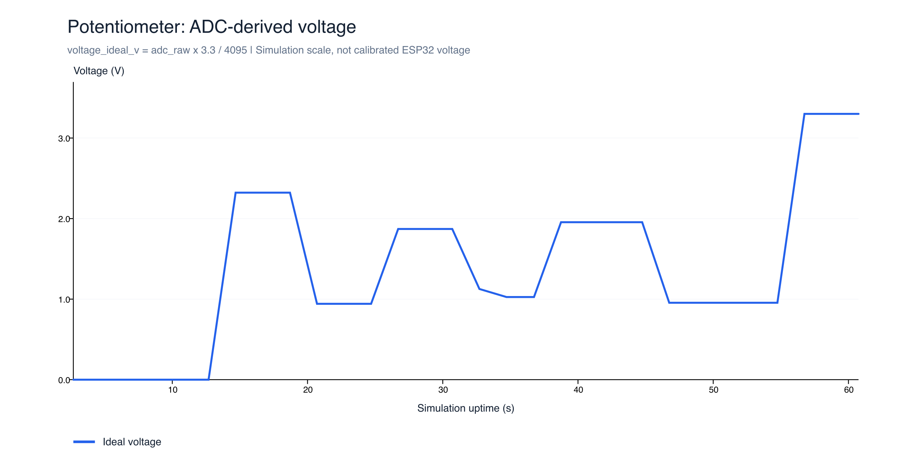
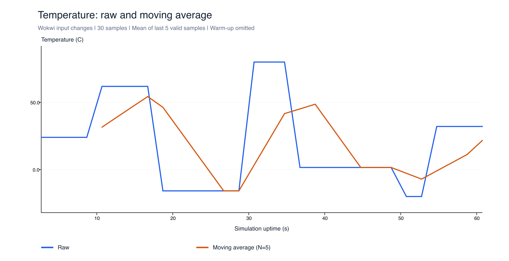
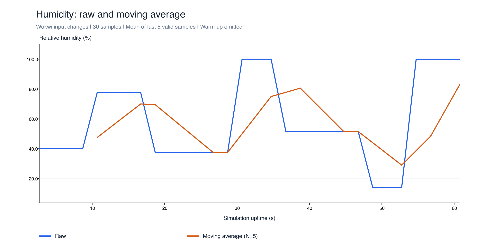
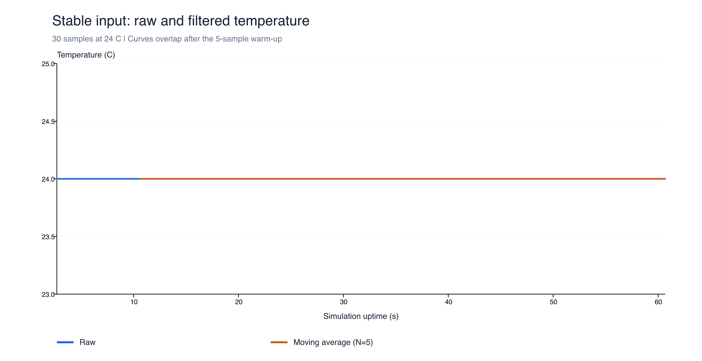
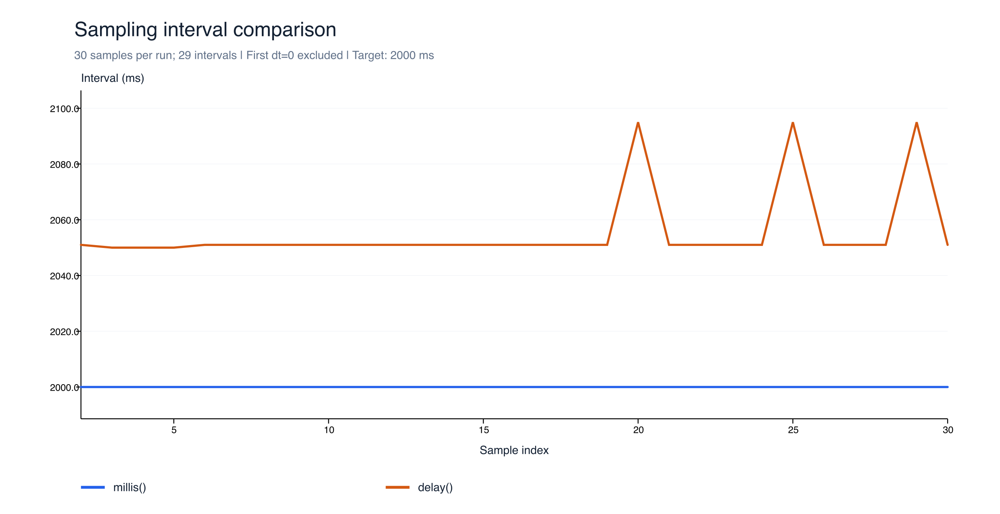
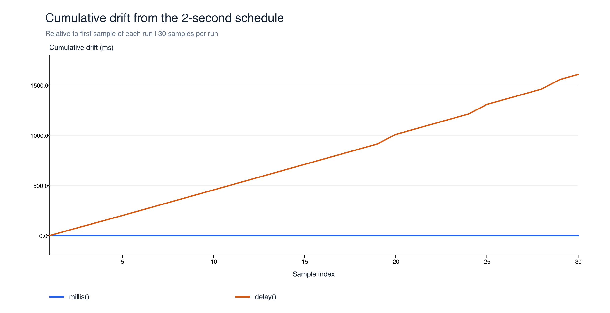
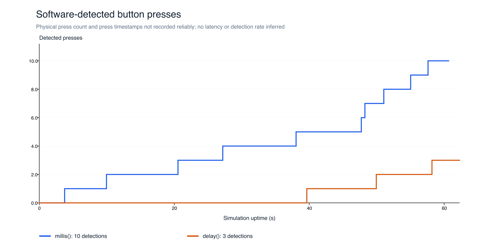

# Bài 2 — Đọc và kiểm tra cảm biến

**Họ tên:** Nguyễn Quang Anh  
**MSSV:** 23110149    
**Dự án:** [ESP32 trên Wokwi](https://wokwi.com/projects/479000472304236545)

## 1. Nội dung hồ sơ

| Tệp/thư mục | Nội dung |
|---|---|
| [code/sensor_millis/sensor_millis.ino](code/sensor_millis/sensor_millis.ino) | Bản dùng mốc thời gian, `BLOCKING = false` |
| [code/sensor_delay/sensor_delay.ino](code/sensor_delay/sensor_delay.ino) | Bản dùng `delay(2000)`, `BLOCKING = true` |
| [data/stable_millis.csv](data/stable_millis.csv) | 30 mẫu ổn định |
| [data/changes_millis.csv](data/changes_millis.csv) | 30 mẫu thay đổi đầu vào, có cột gốc/lọc và ADC |
| [data/fault.csv](data/fault.csv) | 18 mẫu khi ngắt DATA DHT22 |
| [data/timing_millis.csv](data/timing_millis.csv) | 30 mẫu ở lượt thử nút không chặn |
| [data/timing_delay.csv](data/timing_delay.csv) | 30 mẫu ở lượt thử nút chờ dài |
| [data/summary.csv](data/summary.csv) | Thống kê mẫu, lỗi, chu kỳ, độ lệch và sự kiện nút |
| [data/button_events.csv](data/button_events.csv) | Tách các sự kiện nút từ log của từng lượt chạy |
| [data/adc_observations.csv](data/adc_observations.csv) | Giá trị ADC và điện áp quy đổi của lượt thay đổi |
| [logs/](logs/) | Bản chép Serial từng lượt, gồm log khởi động, I²C và nút |
| [charts/](charts/) | Biểu đồ PNG và SVG |

Mở từng thư mục sketch riêng khi dùng Arduino. Trên Wokwi chỉ sao chép một bản vào `sketch.ino`, không đưa cả hai tệp `.ino` vào cùng dự án đang biên dịch.

## 2. Cấu hình và môi trường

| Thành phần | Chân linh kiện | Chân ESP32 |
|---|---|---|
| DHT22 | VCC / DATA (SDA) / GND / NC | 3V3 / GPIO14 / GND / bỏ trống |
| Biến trở | VCC / SIG / GND | 3V3 / GPIO34 / GND |
| OLED SSD1306 128×64 | VCC / SDA / SCL / GND | 3V3 / GPIO21 / GPIO22 / GND |
| Nút nhấn | 1.l / 2.l | GPIO27 / GND, dùng INPUT_PULLUP |


### Kết quả ADC và I²C

Trong lượt thay đổi, ADC quan sát được từ 0 đến 4095. Ví dụ ở 14.683 giây: ADC=2882, điện áp quy đổi=2.322 V; ở 20.702 giây: ADC=1169, điện áp quy đổi=0.942 V; ở 56.746 giây: ADC=4095, điện áp quy đổi=3.300 V. Công thức `V_ideal = ADC × 3.3 / 4095`. Đây là quy đổi lý tưởng theo thang mô phỏng, chưa phải điện áp đã hiệu chuẩn trên ESP32 thật. ADC có giới hạn dải và lượng tử hóa, giá trị cực đại không thể biểu diễn mức cao hơn thang này.

Log I²C đầu mỗi lượt:

```text
# I2C scan: SDA=21 SCL=22
# I2C_FOUND,0x3C
# OLED_OK
```

Địa chỉ 7-bit tìm được là **0x3C**. Chương trình đã khởi tạo OLED và gửi dữ liệu lên màn hình. [Ảnh mạch mô phỏng](Wokwi.png).



## 3. Tổng hợp các lượt chạy

| Lượt | Số mẫu | Hợp lệ | Lỗi | Chu kỳ nhỏ nhất–lớn nhất (ms) | Chu kỳ trung bình (ms) | Sự kiện nút ghi nhận |
|---|---:|---:|---:|---|---:|---:|
| Ổn định, millis | 30 | 30 | 0 | 2000–2000 | 2000.000 | 0 |
| Thay đổi, millis | 30 | 30 | 0 | 2000–2035 | 2002.172 | 23 |
| Ngắt DATA | 18 | 0 | 18 | 2000–2000 | 2000.000 | 0 |
| Thử nút, millis | 30 | 30 | 0 | 2000–2000 | 2000.000 | 10 |
| Thử nút, delay | 30 | 30 | 0 | 2050–2095 | 2055.448 | 3 |

## 4. Trả lời câu hỏi

### 4.1. Cấu hình

Em chọn cách A, sử dụng ESP32 trên Wokwi cùng cảm biến DHT22. Dữ liệu DHT22 nối GPIO14; biến trở nối GPIO34; OLED dùng GPIO21/22 cho SDA/SCL; nút nhấn nối GPIO27 và GND. Chu kỳ mục tiêu là 2000 ms. Lý do chọn 2 giây là thư viện DHTesp khai báo chu kỳ lấy mẫu tối thiểu DHT22 là 2000 ms trong `getMinimumSamplingPeriod()`; chu kỳ này cũng phù hợp hướng dẫn thực hành. Cấu hình cảm biến được chỉ định rõ `DHTesp::DHT22`, không dùng tự nhận diện.

Lượt ổn định giữ đầu vào không đổi và thu 30 mẫu hợp lệ: nhiệt độ 24.00 °C, độ ẩm 40.00%; mọi khoảng lấy mẫu sau mẫu đầu đều 2000 ms. Các con số này xác nhận quá trình mô phỏng và lập lịch của lượt chạy, không xác nhận điều kiện môi trường thật.

### 4.2. Cách báo lỗi

Em dừng mô phỏng, ngắt dây DATA giữa DHT22 và GPIO14 rồi chạy lại. Chương trình kiểm tra trạng thái thư viện và giá trị NaN; khi đọc không thành công, chương trình đánh dấu `valid=0`, giữ nhiệt độ/độ ẩm và các cột lọc là `null`, ghi nhãn lỗi chung `dht_read_failed`. Không thay số đo lỗi bằng 0 vì nhiệt độ 0 °C hoặc ADC=0 có thể là giá trị hợp lệ. Nhãn `dht_read_failed` do chương trình đặt; code hiện tại không in mã lỗi thư viện chi tiết nên chưa phân biệt được timeout với checksum từ log này.

Một dòng log thực tế tại mẫu đầu của [lượt lỗi](logs/fault.txt):

```csv
2683,1,0,null,null,0,dht_read_failed,null,null,4095,3.300,0,nonblocking
```

### 4.3. Bộ lọc đã chọn

Em sử dụng **trung bình trượt 5 mẫu hợp lệ gần nhất** cho nhiệt độ và độ ẩm. Sau khi có đủ 5 mẫu, giá trị lọc bằng tổng 5 giá trị chia 5. Bốn mẫu đầu chưa đủ cửa sổ nên xuất `null`; mẫu lỗi không được thêm vào bộ lọc. Nếu đã có dữ liệu trước một khoảng lỗi, cửa sổ giữ các mẫu hợp lệ cũ, nên độ dài thời gian thực của cửa sổ có thể lớn hơn bình thường.

Với đầu vào ổn định, đường gốc và đường lọc trùng nhau ở 24 °C và 40%. Mô phỏng không có nhiễu ngẫu nhiên trong lượt này nên chưa thể kết luận về mức giảm nhiễu phần cứng. Ở lượt thay đổi đầu vào, đường lọc biến đổi từng bước nhỏ hơn và theo sau đường gốc. Ví dụ tại 18.702 giây, nhiệt độ gốc đã xuống −15.80 °C nhưng giá trị lọc còn 46.36 °C. Đến 26.702 giây, khi cửa sổ đã chứa đủ 5 mẫu ở mức mới, giá trị lọc bằng −15.80 °C. Thời gian để đạt hẳn mức mới trong đoạn giữ này là **8 giây**. Với tín hiệu chậm và chu kỳ đều 2 giây, độ trễ danh nghĩa của cửa sổ 5 mẫu là `(5−1)/2 × 2 = 4 giây`; đại lượng này khác thời gian đạt hẳn mức mới sau bước nhảy.

Độ ẩm tại đoạn tương ứng đổi từ 77.50% xuống 37.50%; giá trị lọc còn 69.50% ở 18.702 giây và đạt 37.50% ở 26.702 giây. Như vậy bộ lọc làm mượt biến động nhưng có thể che bớt hoặc làm chậm phản ứng với thay đổi nhanh. Trong lượt thay đổi, một số đỉnh không được giữ đủ lâu nên đường lọc chưa kịp đạt giá trị gốc trước khi đầu vào đổi tiếp. Đây là hệ quả của cửa sổ, không phải lỗi phép tính. Không diễn giải các bước thay đổi do kéo thanh trượt như nhiễu môi trường thực.







### 4.4. Kết quả thí nghiệm lập lịch

Em chạy hai phiên bản cùng mạch và chu kỳ mục tiêu 2000 ms. Bản chờ dài gọi `delay(2000)` trước mỗi tác vụ đọc; bản không chặn so sánh `millis()` với lần lấy mẫu trước để tiếp tục kiểm tra nút trong thời gian chờ. Hai file code giữ các nhánh thử nghiệm giống nhau và chỉ đổi hằng `BLOCKING`.

Ở lượt thử nút không chặn mới, có **30 mẫu và 29 khoảng đo**, tất cả bằng **2000 ms**, độ lệch so với mục tiêu bằng 0 ms ở độ phân giải log. Ở lượt chờ dài mới, có **30 mẫu và 29 khoảng đo** từ **2050 đến 2095 ms**, trung bình **2055.448 ms**, dài hơn mục tiêu trung bình **55.448 ms**, tương đương khoảng **2.772%**. Độ trôi tích lũy so với lịch 2 giây, tính từ mẫu đầu của chính lượt đó, là **1608 ms** ở mẫu 30. Chưa có đo thời gian riêng để quy toàn bộ thời gian tăng thêm cho một tác vụ cụ thể.

Log không chặn ghi nhận **10 sự kiện nút**, từ 3758 ms đến 57612 ms. Lượt chờ dài vẫn ghi nhận được **3 sự kiện**, tại 39648, 49947 và 58195 ms. Các sự kiện thực tế:

```text
# BUTTON,3758,count=1
# BUTTON,57612,count=10
```

```text
# BUTTON,39648,count=1
# BUTTON,49947,count=2
# BUTTON,58195,count=3
```

Log I²C ở mục 2 chứng minh quét đúng bus SDA=21/SCL=22, tìm được OLED 0x3C và khởi tạo thành công.







