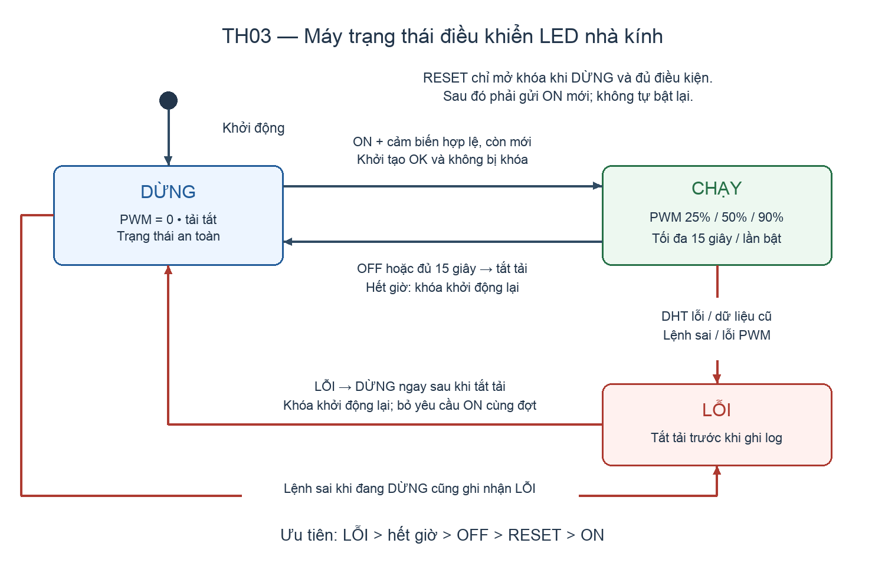

# Bài 3 — Điều khiển thiết bị an toàn

**Họ tên:** Nguyễn Quang Anh  
**MSSV:** 23110149  

## File trong repo này

- [control.ino](control.ino): firmware ESP32, máy trạng thái DỪNG/CHẠY/LỖI, ISR ngắt ngoài, timer phần cứng và PWM.
- [fsm_diagram.png](fsm_diagram.png): sơ đồ trạng thái.
- [fsm_diagram.drawio](fsm_diagram.drawio): nguồn sơ đồ có thể chỉnh sửa.

Chưa có `test_case_1.mp4`, `test_case_2.mp4`, `test_case_3.mp4` và `serial_log.txt`: phải ghi trên mô hình nhà kính thật. Firmware chưa được biên dịch, chạy test hoặc nạp lên ESP32. Những ô “chưa đo” bên dưới không phải kết quả thực nghiệm. Hồ sơ chưa đủ điều kiện nộp cho tới khi bổ sung bằng chứng và thông tin nhóm.

## 4.1 Cấu hình phần cứng

Chọn **LED strip tại J11**, thuộc khối **ARRAY_LED1** trên trang 4/5 của schematic `farm_house_schematic_rev1.0.1.pdf`. Tên khối ARRAY_LED1 khác tên net điều khiển ARRAY_LED3; firmware dùng đúng **GPIO13 / ARRAY_LED3**, không lấy số 1 trong tên khối làm số GPIO. Đường điều khiển là **GPIO13 → VIN chân 3 của U11 (N531) → VOUT chân 1 → gate Q10 (30N06) → J11 chân 2**. Q10 đóng cắt phía mass; J11 chân 1 nối VDC, source Q10 nối GNDD. D9 (DSK115) mắc giữa đầu tải và VDC. Nguồn tải là **VDC của bo**, không phải GPIO hay nguồn 3V3; phải đo VDC và đối chiếu điện áp định mức LED thực tế, không tự coi VDC là 12 V.

Đầu vào gồm DHT11 tại J1: chân 1 là +5V, chân 2 DATA qua R28=22Ω tới net DATA_RH/GPIO14, chân 3 GNDD. R27=3.3kΩ kéo DATA lên +5V theo bản vẽ. **Cần giảng viên kiểm tra/chuyển mức DATA phù hợp 3.3V trước khi nối với ESP32; không coi đường kéo lên 5V là đã an toàn.** Nút thí nghiệm nối net FUNC_BUT/GPIO36 xuống GNDD, dùng điện trở kéo ngoài khoảng 10kΩ lên 3V3 nếu bo chưa có. GPIO36 chỉ vào, không có pull-up nội nên code dùng `INPUT`, không dùng `INPUT_PULLUP`. Không lấy GPIO27 của mô phỏng Bài 2: trên bo này GPIO27 điều khiển LED xanh.

Firmware giả định U11 truyền logic không đảo, HIGH làm tải chạy và LOW làm tải tắt. Schematic chỉ ghi mã N531, chưa có datasheet để xác nhận đặc tính và trạng thái lúc VIN thả nổi. Cần kiểm tra linh kiện thực tế và cực tính trước khi cấp nguồn tải; nếu khác phải sửa phần điều khiển. `setup()` đặt GPIO13 LOW rồi PWM=0, nhưng **code không bảo đảm trạng thái trước khi chạy `setup()`**. Chưa có quan sát tải khi vừa cấp nguồn/chưa nạp code; cần đo gate Q10 và kiểm tra thiết kế kéo xuống/enable của mạch để tải không tự chạy khi ESP32 reset hoặc chưa có firmware. Chỉ cấp điện cho tải sau khi giảng viên kiểm tra.

| Hạng mục | Giá trị từ sơ đồ hoặc đã chọn | Kết quả cần ghi trên bo thật |
|---|---|---|
| Tải | LED strip, J11 | Điện áp/dòng định mức: chưa cung cấp |
| Nguồn tải | VDC, mass GNDD | VDC đo được: chưa đo |
| Điều khiển | GPIO13 → U11 → Q10 | Cực tính và điện áp gate: chưa đo |
| Khởi động/reset | Yêu cầu tải tắt | Quan sát thực tế: chưa thử |
| DHT11 | GPIO14, J1 | Mức DATA sau xử lý phần cứng: chưa đo |
| Nút | GPIO36, kéo ngoài lên 3V3 | Đấu nối thực tế: chưa xác nhận |

## 4.2 Ngắt ngoài

ISR `onButton()` làm đúng một việc là tăng `buttonEdges`, một biến đếm số nguyên `volatile uint32_t`, ở mỗi cạnh xuống của GPIO36. Không in Serial, đọc DHT hay chờ trong ISR. Vòng `loop()` đọc bộ đếm và xử lý chống dội bằng thời gian: chỉ công nhận lần nhấn khi mức LOW ổn định tối thiểu **25 ms**, rồi phải có một lần nhả ổn định để công nhận lần tiếp theo. Bộ đếm `raw` vẫn giữ số cạnh ngắt gốc cả khi bật chống dội; `accepted` là số sự kiện sau xử lý, vì vậy không nhầm raw ISR với số lần bấm vật lý. Nút chỉ phục vụ thí nghiệm đếm, không bật/tắt tải; dùng lệnh `OFF` để dừng bình thường.

Chạy trước khi thử máy trạng thái, giữ tải ở DỪNG. Gửi `DEBOUNCE OFF`, nhả nút rồi gửi `CLEAR`; bấm đúng 10 lần rõ ràng, gửi `STATUS` và ghi `raw`/`accepted`. Tiếp tục `DEBOUNCE ON`, nhả nút, `CLEAR`, bấm lại 10 lần, ghi số đếm. Mỗi lần nhấn/nhả nên giữ trên 50 ms. Lặp lại lượt bật chống dội trong lúc các dòng `SENSOR` đang xuất, ghi số cạnh ISR và số lần công nhận khi CPU đọc cảm biến.

| Lượt | Số lần bấm vật lý cần thực hiện | raw ISR thực đo | accepted thực đo |
|---|---:|---|---|
| Không chống dội | 10 | Chưa đo | Chưa đo |
| Chống dội 25 ms | 10 | Chưa đo | Chưa đo |
| Chống dội, khi CPU đọc DHT11 | 10 | Chưa đo | Chưa đo |

Chưa thể kết luận đếm đủ 10 lần. Thư viện DHT có đoạn giao tiếp chặn ngắn và có đoạn khóa ngắt; không khẳng định ngắt luôn thu đủ mọi cạnh khi đọc DHT. Lượt “CPU bận” phải kiểm chứng bằng số liệu thật, gồm cả raw và accepted; nếu thiếu phải ghi rõ và điều chỉnh cách đọc cảm biến/thu nhận nút.

## 4.3 Timer phần cứng và PWM

Chọn **Arduino-ESP32 3.x**: `timerBegin(1000000)` tạo bộ đếm 1MHz; `timerAlarm(..., 2000000, true, 0)` tạo sự kiện định kỳ mục tiêu **2 giây**, tự lặp. ISR `onTimer()` chỉ tăng `timerTicks`, xử lý và in log ở vòng lặp. Dòng `TIMER` có `tick`, `delta_ticks`, `service_dt_us`. Đây là **khoảng thời gian vòng lặp tiếp nhận sự kiện**, chứa cả độ trễ xử lý DHT/Serial; không phải phép đo trực tiếp jitter tại thời điểm ISR. Bỏ mẫu đầu (`service_dt_us=0`); chỉ dùng mẫu có `delta_ticks=1` khi tính các khoảng đơn. `delta_ticks>1` cho biết nhiều sự kiện đã gộp trước khi vòng lặp kịp xử lý. Nếu cần đo chính xác chu kỳ ngắt, dùng thiết bị đo/firmware đo riêng được giảng viên chấp thuận; không diễn giải log foreground thành độ chính xác phần cứng.

Thu tối thiểu 30 khoảng hợp lệ, tính chu kỳ trung bình, nhỏ nhất, lớn nhất; sai lệch trung bình = trung bình đo − 2,000,000µs. Chưa có dữ liệu TH03 nên chưa kết luận timer ổn định hơn Bài 2. Khi đối chiếu Bài 2 cần ghi rõ Bài 2 chạy Wokwi, TH03 chạy bo thật: khác môi trường nên không quy mọi sai lệch cho cách lập lịch.

| Đại lượng timer | Kết quả |
|---|---|
| Chu kỳ đặt | 2,000,000 µs |
| Số khoảng đã thu | Chưa đo |
| Trung bình / nhỏ nhất / lớn nhất | Chưa đo |
| Sai lệch trung bình so với giá trị đặt | Chưa đo |
| Nhận xét đối chiếu `millis()` Bài 2 | Chưa đủ số liệu TH03 |

PWM dùng LEDC tại GPIO13, **1kHz, 8bit**, thử ba mức 25%, 50%, 90%. Giá trị làm tròn tương ứng 64/255, 128/255, 230/255 nên duty biểu diễn xấp xỉ 25.10%, 50.20%, 90.20%. Gửi `OFF`, `DUTY 25`, chờ một dòng `SENSOR` hợp lệ rồi `ON`; quan sát/chụp hình, `OFF`. Lặp lại với 50 và 90. Đổi duty khi đang CHẠY bị coi là lỗi thao tác và làm tắt tải; mỗi lượt phải dừng trước. PWM vẫn chịu giới hạn chạy 15 giây. Dự kiến LED sáng hơn khi tăng duty, nhưng quan sát thực tế còn phụ thuộc driver và tải; không điền dự kiến vào cột kết quả.

| Duty yêu cầu | Giá trị PWM | Quan sát/ảnh trên nhà kính |
|---|---:|---|
| 25% | 64 | Chưa thử |
| 50% | 128 | Chưa thử |
| 90% | 230 | Chưa thử |

## 4.4 Kết quả ba ca thử

Máy trạng thái mặc định **DỪNG**, chỉ nhận `ON` khi PWM/timer khởi tạo được, DHT11 đã có dữ liệu hợp lệ còn mới và không bị khóa sau lỗi/quá giờ. Thời gian chạy tối đa chọn **15,000ms**, tính từ lúc bật; gửi lại `ON` khi đang chạy không kéo dài hạn. Lỗi có ưu tiên cao nhất, tiếp theo là hết giờ, `OFF`, `RESET`, cuối cùng `ON`. Khi lỗi, code tắt PWM trước rồi ghi `LỖI → DỪNG`; LỖI là trạng thái chuyển tiếp, không giữ tải chạy để chờ người xử lý. Hết giờ đi thẳng về DỪNG. Sau lỗi/quá giờ cần `RESET` hợp lệ rồi gửi một lệnh `ON` mới; code không tự chạy lại khi cảm biến phục hồi. Các lệnh bật đang xếp hàng không vượt qua khóa này.

`updateState()` không dùng `delay()`; kiểm tra lỗi/hạn ở đầu vòng lặp và sau giao tiếp DHT. Giao tiếp DHT và Serial vẫn có độ trễ hữu hạn, vì vậy thời điểm tắt thực tế có thể muộn hơn mốc 15 giây một khoảng xử lý; chưa đo độ trễ và không coi đây là hệ thống dừng cứng đúng từng microsecond. DHT đọc mỗi 2 giây; tháo cảm biến chỉ được phát hiện ở lần đọc tiếp theo. Lệnh sai định dạng cho phép tạo Ca 3 mà không phải rút dây khi mạch đang cấp nguồn.

| Ca | Đầu vào và thao tác | Kỳ vọng |
|---|---|---|---|
| 1 — bình thường | Chờ `SENSOR ... valid=1`, gửi `DUTY 50`, `ON`; sau khoảng 3 giây gửi `OFF` | DỪNG → CHẠY → DỪNG, LED bật rồi tắt |
| 2 — quá giờ | Gửi `ON`, chờ trên 15 giây, không gửi `OFF` | Tự DỪNG, duty=0, reason=timeout, locked=1 |
| 3 — lệnh lỗi | Sau Ca 2 gửi `RESET` khi cảm biến hợp lệ, gửi `ON`; khi đang CHẠY gửi `ONN` | Tắt tải; LỖI reason=bad_command → DỪNG, locked=1 |

Có thể bổ sung thử mất DHT theo hướng dẫn giảng viên, kỳ vọng lần đọc tiếp theo báo `dht_read_failed` và tải tắt. Chưa có quan sát, nguyên nhân lỗi phần cứng hay sửa chữa nào để báo cáo. Sau mỗi ca cần ghi đầu vào, thời điểm log, quan sát LED, kết luận đạt/không đạt và lý do; đặt ba video cùng thư mục README theo tên `test_case_1.mp4` đến `test_case_3.mp4`, lưu toàn bộ Serial nguyên gốc vào `serial_log.txt`. Không chép log tự dựng làm bằng chứng.

## Nguồn đối chiếu

- Đề TH03, mục 3, 4, 7 và câu hỏi 4.1–4.5; schematic Farm House rev1.0.1, trang 4/5.
- [Espressif — Timer API](https://docs.espressif.com/projects/arduino-esp32/en/latest/api/timer.html).
- [Espressif — LEDC API](https://docs.espressif.com/projects/arduino-esp32/en/latest/api/ledc.html).
- [Espressif — GPIO và điện trở kéo](https://docs.espressif.com/projects/esp-idf/en/latest/esp32/api-reference/peripherals/gpio.html).
- [Adafruit — DHT sensor library 1.4.6](https://github.com/adafruit/DHT-sensor-library/tree/1.4.6).

Nộp một link repo Git cá nhân lên mục TH03 trên SV20 sau khi commit đủ firmware, sơ đồ, ba video, log thật và README đã cập nhật kết quả.
