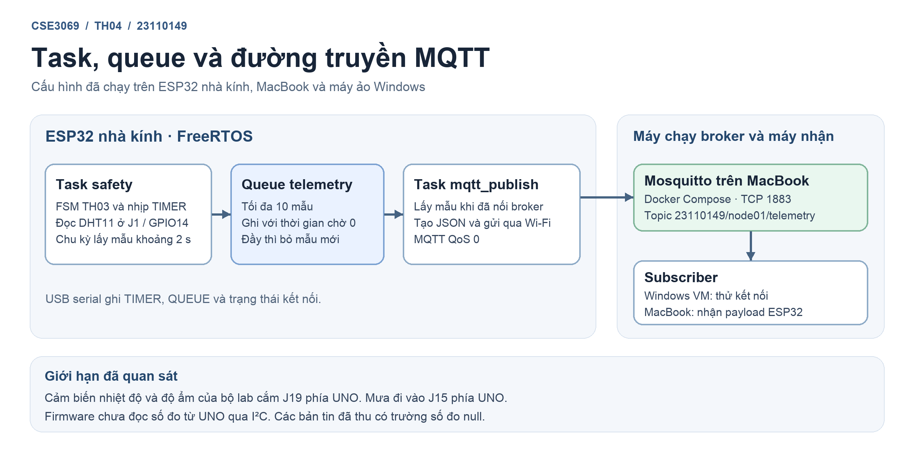

# Bài 4 — Gửi dữ liệu qua MQTT

**Họ tên:** Nguyễn Quang Anh  
**MSSV:** 23110149  
**Học phần:** CSE3069 — Phát triển ứng dụng IoT  
**Hình thức:** Cá nhân

ESP32 trên mô hình nhà kính đã gửi bản tin MQTT tới Mosquitto chạy bằng Docker Compose trên MacBook. Lượt thử ngày 10/11/2026 ghi nhận ESP32 tự kết nối lại sau khi broker dừng 30 giây. Các bản tin đã quan sát có trường số đo `null`, vì vậy phần thu số đo thật còn dang dở.

## Mục lục

- [1. Nội dung hồ sơ](#1-nội-dung-hồ-sơ)
- [2. Môi trường đã dùng](#2-môi-trường-đã-dùng)
- [3. Kết quả kiểm chứng](#3-kết-quả-kiểm-chứng)
- [4. Trả lời câu hỏi](#4-trả-lời-câu-hỏi)

## 1. Nội dung hồ sơ

| Tệp hoặc thư mục | Nội dung |
|---|---|
| [docker-compose.yml](docker-compose.yml) | Service Mosquitto 2.0.22, mở cổng TCP 1883 |
| [mosquitto.conf](mosquitto/config/mosquitto.conf) | Cấu hình listener và xác thực bằng tệp tài khoản |
| [firmware/](firmware/) | Project PlatformIO cho ESP32, gồm FSM an toàn, queue và task MQTT |
| [topic_payload.md](topic_payload.md) | Topic và ý nghĩa các trường payload |
| [task_queue.png](task_queue.png) · [tệp draw.io](task_queue.drawio) | Sơ đồ task, queue và các máy tham gia |
| [log_disconnect.txt](log_disconnect.txt) | Log ESP32 qua USB và log Mosquitto của lượt dừng broker 30 giây |
| [log_queue_observed.txt](log_queue_observed.txt) | Trích các lần queue đầy trong chính lượt dừng broker |
| [logs/](logs/) | Log serial gốc dùng để đối chiếu |

## 2. Môi trường đã dùng

| Thành phần | Cấu hình đã dùng |
|---|---|
| Node | ESP32 nhà kính, nạp bằng PlatformIO qua USB |
| Broker | Mosquitto trong Docker Desktop trên MacBook |
| Máy quan sát | PowerShell trong máy ảo Windows trên cùng MacBook. Máy ảo đã nhận bản tin thử `th04/check` |
| Topic của ESP32 | `23110149/node01/telemetry` |



## 3. Kết quả kiểm chứng

| Nội dung | Kết quả |
|---|---|
| Broker và đường truyền | Windows VM đã nhận bản tin thử. Sau khi nạp, một subscriber trên MacBook nhận trực tiếp JSON do ESP32 publish |
| Số đo nhiệt độ, độ ẩm, mưa | Lượt thử trả `null`. Cảm biến nhiệt độ và độ ẩm trên bộ dùng trong lab cắm ở nhánh UNO `J19/D8`, còn firmware đang đọc nhánh ESP32 `J1/GPIO14`. Mưa nối UNO `J15/A2`. Phần nhận số đo từ UNO qua I²C chưa triển khai |
| Tách task và queue | ESP32 chạy task `safety` và task `mqtt_publish`. Trong lượt broker tắt, log ghi 5 mẫu mới bị bỏ sau khi queue đầy |
| Ngắt và kết nối lại | Broker tắt 30 giây. Mosquitto ghi nhận ESP32 tự kết nối lại sau khoảng 2 giây kể từ khi broker chạy lại |
| Log 10 phút | Chưa thu được `log_10min.txt` có số đo thật trên máy nhận |
| Thử làm chậm task MQTT | Chưa chạy lượt riêng với broker vẫn hoạt động. File `log_queue_observed.txt` ghi hiện tượng queue đầy trong lượt ngắt broker |

## 4. Trả lời câu hỏi

### 4.1. Payload thực tế

Đây là một bản tin đã nhận trực tiếp từ ESP32 trên topic `23110149/node01/telemetry` trong lượt kiểm tra broker.

```json
{"device_id":"node01","ts_ms":124535,"temp_c":null,"humidity_pct":null,"rain_adc":null,"valid":false}
```

`device_id` nhận diện node nhà kính và `ts_ms` là thời gian lấy mẫu tính bằng mili giây kể từ lúc bo khởi động. `temp_c` dùng °C, `humidity_pct` dùng %RH và `rain_adc` dự kiến mang số đếm ADC thô. `valid` đánh dấu chất lượng của toàn bộ mẫu. Bản tin này có `valid:false` vì chưa có số đo hợp lệ. Một trường `null` biểu thị dữ liệu thiếu hoặc lỗi đọc. Giá trị số `0` vẫn có thể hợp lệ.

### 4.2. Task và queue

Task `safety` xử lý FSM TH03, lệnh serial và đọc DHT11 theo chu kỳ mục tiêu 2 giây. Task đưa mẫu vào queue 10 phần tử mà không chờ chỗ trống. Khi queue đầy, chương trình giữ các mẫu đang chờ, bỏ mẫu mới và tăng `total_dropped`. Khi đã nối broker, task `mqtt_publish` lấy mẫu từ queue, tạo JSON và gửi. Việc gửi qua mạng nằm trong task riêng, nên task an toàn có thể kiểm tra trạng thái và thời hạn chạy ngay cả khi MQTT đang chờ hoặc kết nối lại.

### 4.3. Thí nghiệm ngắt kết nối

Ngày 10/11/2026, Terminal ghi broker dừng lúc **13:01:01** và chạy lại lúc **13:01:31** theo giờ Việt Nam. ESP32 báo mất kết nối lúc **13:01:02.221**. Trong đoạn serial đã lưu, `TIMER` tăng từ tick 5 đến tick 15, xấp xỉ 2 giây mỗi tick. Queue đầy lần đầu lúc **13:01:14.889** và ghi nhận 5 mẫu mới bị bỏ trước khi log serial kết thúc lúc **13:01:22.907**. Log Docker xác nhận ESP32 kết nối lại lúc **13:01:33.235**. Vì serial kết thúc trước khi broker bật lại, bằng chứng về các tick chỉ bao phủ đoạn đã ghi, còn bằng chứng kết nối lại đến từ Mosquitto. [Xem log đối chiếu](log_disconnect.txt).

### 4.4. Đóng góp cá nhân

Em thiết lập broker và tài khoản MQTT trên MacBook, dùng PowerShell trong máy ảo Windows để thử subscribe, cấu hình Wi‑Fi và MQTT, build và nạp chương trình lên ESP32, sao lưu firmware gốc và thực hiện lượt dừng broker 30 giây. [Log thí nghiệm](log_disconnect.txt) là minh chứng cho lượt chạy. Codex hỗ trợ viết và sửa firmware, phân tích log, đối chiếu sơ đồ mạch và biên tập hồ sơ.
